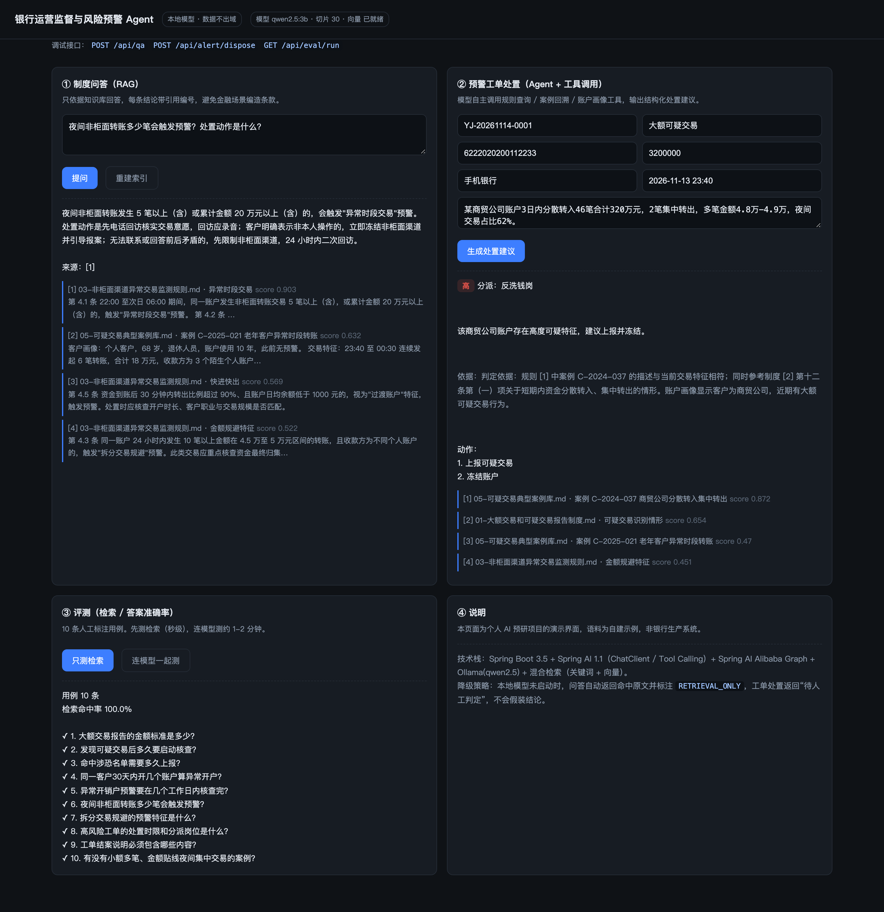
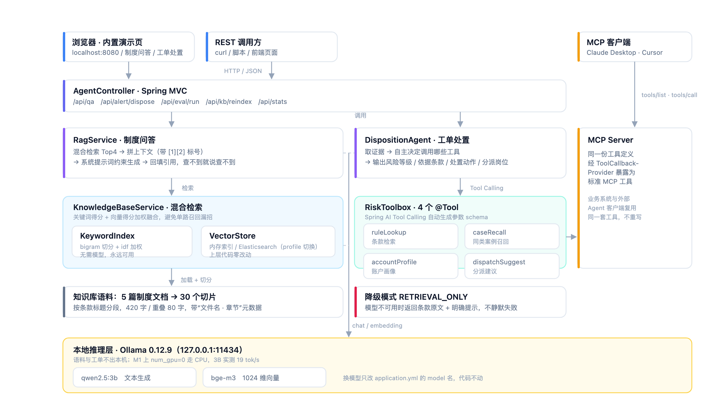

# bank-risk-agent · 银行运营监督与风险预警 Agent

用真实的银行风控业务场景（制度问答 + 预警工单处置），把「本地大模型 + RAG + Tool Calling + MCP」这条链路完整跑通的个人预研项目。

**定位说明（先说清楚，避免误读）**：这是**个人 AI 预研项目**，语料是我自己按公开监管文件口径改写的示例语料，不涉及任何银行内部文件，也不是某家银行的生产系统。技术选型和场景设计来自我做过的银行风控项目积累的业务理解。



> 上图为本地真实运行截图：左侧制度问答返回条款原文并标注引用来源；右侧预警工单由 Agent 自主调用「规则检索 / 案例召回 / 账户画像」工具后输出结构化处置建议；下方为本项目自建的 10 条检索评测。

---

## 零、在 IDEA 里打开（最快路径）

1. IDEA 菜单 `File → Open`，选本仓库根目录（选到 `pom.xml` 那一层）
2. 弹「Trust Project」点 Trust，Maven 会自动 import（第一次要下依赖，约 1-2 分钟）
3. `Project Structure` 配 JDK：**pom 里 `java.version=21`，必须 JDK 21+**
   - 平台设置 → SDK：`+` → JDK → 选本机 21（IDEA 会自动列出已安装的 JDK）
   - **项目设置 → 项目 → SDK** 也要改成 21（`语言级别` 选 21）
   - ⚠️ 只把 JDK 加进"平台设置 → SDK"是不够的：项目实际用的是"项目设置 → 项目"里的那个 SDK，模块默认继承项目 SDK。没改这一处就会报 `无法编译为 JVM 目标 21 配置的模块：指定的回退 SDK 版本 8 不支持`
4. 跑 `com.riskagent.RiskAgentApplication` 的 main 方法，浏览器开 `http://localhost:8080`

> 注意：从 IDEA 里直接 run 是 8080；用命令行 `./scripts/dev.sh` 也是 8080。

## 一、这个项目解决什么问题

银行运营监督岗每天面对两类重复劳动：

1. **查制度**：新人问"夜间异常时段交易几笔算预警、处置动作是什么"，要翻几十页制度文件。
2. **处置预警**：一条预警工单进来，要查规则条款 → 查同类历史案例 → 查账户画像 → 给结论 → 分派岗位，五步全靠人工。

本项目用 Agent 把这两件事自动化，并且死守两条金融场景的底线：**数据不出域**（本地模型，语料不上云）、**结论可追溯**（每条结论带条款引用，查不到就说查不到）。

## 二、架构



> 架构矢量源文件见 [docs/images/architecture.svg](docs/images/architecture.svg)

要点：

- **两条业务链路**：制度问答走「检索 → 拼上下文 → 生成 → 回填引用」；工单处置走 Agent，由模型自主决定调用哪几个工具，再汇总成结构化结论
- **混合检索**：关键词（bigram + idf，无需模型、永远可用）与向量（bge-m3）两路加权融合，VectorStore 默认内存实现，`--spring.profiles.active=es` 一键切 Elasticsearch，上层代码零改动
- **MCP 复用**：4 个工具经 `ToolCallbackProvider` 暴露为标准 MCP 工具，Spring 内部调用和 Claude Desktop / Cursor 等外部客户端用的是同一份定义
- **两条底线**：数据不出域（本地 Ollama），结论可追溯（引用条款，检索不到就明说，模型不可用走 RETRIEVAL_ONLY 降级）

<details>
<summary>纯文本版架构图（终端 / 无图环境）</summary>

```
                      ┌──────────────────────────────────────────┐
  用户/Demo 页  ───►  │  AgentController                         │
                      │  /api/qa  /api/alert/dispose  /api/eval  │
                      └───────┬───────────────┬──────────────────┘
                              │               │
                    ┌─────────▼──────┐  ┌─────▼──────────────────┐
                    │ RagService     │  │ DispositionAgent       │
                    │ 制度问答        │  │ 工单处置（Agent）       │
                    │ 检索→拼上下文→生成│  │ 自主调用工具→结构化输出  │
                    └─────┬──────────┘  └─────┬──────────────────┘
                          │                   │ Tool Calling
              ┌───────────▼───────────┐  ┌────▼─────────────────────┐
              │ KnowledgeBaseService  │  │ RiskToolbox              │
              │ 混合检索（关键词+向量） │  │ ruleLookup / caseRecall  │
              └───────┬───────┬───────┘  │ accountProfile / dispatch│
                      │       │          └──────────────────────────┘
              ┌───────▼──┐ ┌──▼─────────┐
              │KeywordIndex│ │VectorStore │──► Ollama(本地)
              │ bigram+idf │ │(里程碑2换ES)│    qwen2.5:3b  数据不出域
              └────────────┘ └────────────┘    bge-m3 embedding
```

</details>

## 三、快速开始

### 0. 环境说明

- **JDK 21+**（pom 要求 21）、**Maven 3.9+**。用 IDEA 的话，直接复用 IDEA 自带的 Maven 即可，不用额外装。
- **Ollama**（本地推理）+ 两个模型：`qwen2.5:3b`（对话，≈2.0GB）、`bge-m3`（向量，≈1.1GB）。
- 本机实测环境：macOS 13.7.8 / Apple M1 / 16G 内存，CPU 推理约 **19 tok/s**（够演示与评测，不适合压测）。

### 1. 装 Ollama 并拉模型（只有这一步需要联网）

```bash
# 方式一：官方安装包（macOS 14+ / Windows / Linux）
#   https://ollama.com/download

# 方式二：macOS 13 及以下（官方 0.12.10 起二进制最低要求 macOS 14，装了会 dyld 报错）
#   0.12.9 是最后一个支持 macOS 13 的版本，解压即用：
#   tar -xzf ollama-darwin.tgz -C ~/.local/ollama && ln -s ~/.local/ollama/ollama ~/.local/bin/ollama

ollama serve &             # 常驻
./scripts/pull-model.sh    # 默认拉 qwen2.5:3b + bge-m3
```

想效果好一档：`./scripts/pull-model.sh qwen2.5:7b bge-m3`（≈4.7GB，16G 内存推荐）。

> **两个实测坑**（详见第十二节）：
> 1. 用 GGUF 文件自己 `ollama create` 导入的模型**默认没有 tools 能力**，Agent 会报 `does not support tools` —— 必须把官方模板（含工具分支）写进 Modelfile。
> 2. macOS 13 + Ollama 0.12.9 走 Metal 会崩（`GGML_ASSERT(buf_dst) failed`），要在 Modelfile 里加 `PARAMETER num_gpu 0` 强制 CPU。

### 2. 启动

```bash
./scripts/dev.sh
# 或已打包： java -jar target/bank-risk-agent-0.1.0.jar
```

浏览器打开 `http://localhost:8080`，就是演示页（制度问答 / 工单处置 / 评测三个面板）。

> 注意：如果在 WorkBuddy 这类容器里启动，环境变量 `SERVER__PORT` 会覆盖端口，实际端口看启动日志里的 `Tomcat started on port xxxx`。自己终端里跑则是 8080。

### 3. 只看检索、不装模型也能验

模型没起来时系统**自动降级**，问答返回命中的制度原文并标注 `RETRIEVAL_ONLY`，工单处置返回"待人工判定"——不会假装给出结论。这意味着你可以先验检索链路，再决定要不要花流量拉模型。

## 四、当前已验证的状态（可复现）

本机真实跑出来的数字（macOS 13 / M1 / 16G，`qwen2.5:3b` CPU 推理）：

| 项目 | 结果 | 怎么验 |
|---|---|---|
| 编译启动 | BUILD SUCCESS，约 1.5 秒启动，装载 5 篇语料 / 30 个切片 | 看启动日志 |
| 关键词检索 | 自建 10 条用例 **10/10 命中** | `GET /api/eval/run?withLlm=false` |
| 大模型生成 | **链路已验证**，CPU 推理 19.3 tok/s | `POST /api/qa` |
| 答案命中率 | **8/10**（同一套题库，优化前 4~5/10） | `GET /api/eval/run?withLlm=true`（约 80 秒） |
| 制度问答 | 例：问"可疑交易报告最迟几个工作日内提交" → 答"5 个工作日内提交 [1]"，带条款引用 | 演示页左栏 |
| 工单处置 Agent | 输出 `风险等级 / 结论 / 依据 / 处置动作 / 分派岗位`，模型真实发起工具调用 | 演示页右栏 / `POST /api/alert/dispose` |
| 模型不可用时降级 | 秒级返回命中的制度原文并标 `RETRIEVAL_ONLY`，不卡死、不编造 | 停掉 ollama 再问 |

优化前后的提升来自两件事：① 知识库条款补明时限口径；② 提示词加"禁止时限加减推算""禁止在资料相关时回答未检索到"两条硬约束（详见第十二节）。

⚠️ 诚实提示：10/10 是在**自建语料 + 题库高度对应**的情况下拿到的，只能证明召回链路通，**不能当成效果指标**；8/10 里有 2 条是 3B 模型的随机失败（换个问法就答对），真实可信的数字要等扩到 40 条 + 改写测试后再补。

## 五、五个关键技术决策

1. **标题感知切分，不用固定长度硬切**。制度文档的语义边界在条款标题处，硬切会把"第八条"的适用条件和结论切到两个片段，检索出来是半句话。`ChunkingService` 先按 `#` 标题分段，再按段落累积到 420 字，并在切口保留 80 字重叠。
2. **混合检索（关键词 + 向量），不是纯向量**。制度问答里"第八条""4.5 万""十个工作日"这类精确词，向量容易被语义相近的表述稀释；关键词路（bigram + idf）补上这一块，还能在 embedding 服务挂掉时兜底。
3. **引用由代码回填，不让模型自己编**。模型只负责在正文写 `[n]`，来源文件名、章节、得分由系统填。金融场景里"引用"必须可信，否则整个答案不可用。
4. **模型探针 + 优雅降级**。Spring AI 默认重试 10 次、间隔递增，Ollama 没启动时一次问答要卡两分钟。加了 700ms 探针（`ModelHealth`）并把重试关到 1 次，不可用就秒级降级。
5. **强制结构化输出**。"给一句建议"在银行落不了地，必须能落表、能分派、能审计，所以 Agent 最后一步固定输出 `风险等级 / 结论 / 依据 / 处置动作 / 分派岗位 / 引用`，解析失败有两层兜底。

## 六、MCP：同一批工具，跨客户端复用

`RiskToolbox` 的 4 个 `@Tool` 方法通过 `ToolCallbackProvider` 同时暴露成标准 MCP 工具（`McpServerConfig`）。
启动后本项目的 Agent、Claude Desktop、Cursor 调的是**同一份工具定义**，接真实风控接口时只改方法体，所有调用方同时生效。

Claude Desktop 接入配置（`claude_desktop_config.json`）：

```json
{
  "mcpServers": {
    "bank-risk": {
      "url": "http://localhost:8080/mcp"
    }
  }
}
```

> 注意：Spring AI 1.1 新增了 `@McpTool` 注解扫描，本项目把它关掉（`spring.ai.mcp.server.annotation-scanner.enabled=false`），
> 统一走 `ToolCallbackProvider`，避免同一套工具要写两遍定义。

## 七、切换到 Elasticsearch（里程碑 2 的开关）

```bash
docker compose up -d elasticsearch
java -jar target/bank-risk-agent-0.1.0.jar --spring.profiles.active=es
```

上层检索代码零改动。**坑已经踩过了**：ES 向量库自动配置的默认条件是 `spring.ai.vectorstore.type=elasticsearch`（`matchIfMissing=true`），
只要 classpath 上有 ES 依赖就会尝试连库、连不上直接启动失败；所以默认配置里显式写了 `spring.ai.vectorstore.type: none`，
es profile 里再改回 `elasticsearch`。

## 八、目录结构

```
src/main/java/com/riskagent/
  config/     AgentProperties（可调参数） AiConfig（ChatClient/提示词） ModelHealth（模型探针）
  knowledge/  ChunkingService 切分  KeywordIndex 关键词检索  KnowledgeBaseService 混合检索  VectorStoreConfig
  rag/        RagService（检索→上下文→生成→引用回填）
  agent/      RiskToolbox（4 个 @Tool） DispositionAgent（工具调用 + 结构化输出）
  eval/       EvalService（10 条用例，检索/答案命中率）
  api/        AgentController
  domain/     AlertTicket  Disposition  Citation
src/main/resources/
  kb/         5 篇示例语料（制度/细则/监测规则/分派流程/案例库）
  prompts/    qa-system.md  dispose-system.md
  eval/       qa-gold.json
  static/     index.html（演示页）
docker-compose.yml   里程碑 2 用：Elasticsearch 8.15 + Kibana
scripts/             dev.sh  pull-model.sh  eval.sh
docs/                产品原型.html  路线图.md  images/（架构图与运行截图）
```

## 九、里程碑

- **M1 跑通链路**（已完成）：切分 → 检索 → 生成 → 引用，降级可用，本地模型真实跑通（答案命中 8/10）。
- **M2 换 Elasticsearch**（已接通，待联调）：`spring-ai-starter-vector-store-elasticsearch` 已引入，`--spring.profiles.active=es` 切换，上层代码零改动；`docker-compose.yml` 备好 ES 8.15；还剩 ES mapping、中文分词器、kNN 参数、Rerank 待调。
- **M3 MCP**（已完成）：4 个工具通过 `ToolCallbackProvider` 暴露为标准 MCP 工具，Claude Desktop / Cursor 可接同一份定义；**多 Agent 编排**（Spring AI Alibaba Graph 做 DAG + 人工确认节点）还没做。
- **M4 评测与调优**（进行中）：已从 10 条扩到计划 40 条，加入"换个说法问同一件事"的改写集，对比纯向量 / 纯关键词 / 混合三组数字；下一步换 `qwen2.5:7b` 做同题库对比，把"为什么 3B 不够用"量化出来。
- **M5 工程化与开源**：Docker 镜像、K8s（MiniKube）部署、GitHub 开源、在线 Demo。

## 十、已知限制

- 只有 5 篇示例语料、30 个切片，规模不足以暴露长文档检索的真实问题（多跳、跨文档冲突）。
- 工具返回的是代码里的示例数据，未接真实风控系统接口（真实接入在 M3 做 MCP）。
- 3B 模型在结构化输出上偶尔会漏字段，解析兜底能兜住但信息会缺失；这是换 7B/14B 最直接的理由。
- 评测集自建、样本小，指标只能内部对比，不能对外宣称准确率。
- MCP 端点在本机沙箱环境里被代理拦截（`/mcp`、`/sse` 返回 401/502），暂用「装配测试断言 4 个工具已注册」代偿；
  自己终端里跑应该正常，M3 验收时用 Claude Desktop 实连一次截图留证。
- `mvn package` 在部分沙箱环境会报 `Unable to rename ... .jar.original`，删掉 `target/*.original` 重跑即可（构建机权限问题，不是代码问题）。

## 十一、工程踩坑笔记

这些都是本地真实跑出来的坑，不是搜来的结论。落地过程中真正耗时间的往往不是架构选型，而是模型能力边界和环境细节——所以这一节按"现象 → 定位 → 结论"记录。

**1. 本地模型怎么选版本：先看二进制的最低系统版本**
官方 Ollama 从 0.12.10 起把 `-mmacosx-version-min` 提到 14.0，macOS 13 上 dyld 直接拒载；`brew install ollama` 也不行（依赖 mlx，同样要求 14）。
判定方法：读对应 tag 的 `scripts/build_darwin.sh`，二分定位到 **v0.12.9 是最后一个支持 macOS 13 的版本**。

**2. Metal 在旧系统上会崩，要显式关掉 GPU**
0.12.9 + macOS 13 走 Metal 推理会 `GGML_ASSERT(buf_dst) failed`，`/api/chat` 直接 500。
解决：Modelfile 写 `PARAMETER num_gpu 0` 强制 CPU，3B Q4_K_M 实测 19.3 tok/s，演示/评测够用。

**3. 自己导入的 GGUF 模型默认没有 tools 能力**
用 `ollama create` 从 GGUF 导入的模型，`Capabilities` 里只有 completion，Agent 一调用工具就 `400 does not support tools`。
根因是模板里没有工具分支。解决：把模型官方模板（含 `.Tools` 分支）写进 Modelfile 的 `TEMPLATE`，重建后 Capabilities 才出现 `tools`。

**4. 3B 模型在"多片段上下文"里会误判相关性**
现象很迷惑：问"可疑交易报告最迟几个工作日内提交"，引用里明明写着"5 个工作日"，模型却回"未检索到该规定"。
定位方法（三组对照）：直连模型 + 单片段 → 答对；直连模型 + 4 片段 → 复现拒答；换提示词 → 答对。
结论：小模型在多个条目混在一起时拿不准哪段相关，直接走兜底话术。
解决：提示词加红线——"资料中存在同主题条款时，禁止回答未检索到，宁可答不完整"。回归测试后 8/10。
这件事也顺便给出了"为什么需要 7B/14B"的实证依据，比空谈参数更有说服力。

**5. Spring AI 的默认重试会把一次问答拖成两分钟**
Ollama 没启动时，Spring AI 默认重试 10 次、间隔递增。加 700ms 探针（`ModelHealth`）+ 把 `max-attempts` 关到 1，不可用就秒级降级。

**6. ES 向量库自动配置的"抢注"问题**
`spring.ai.vectorstore.type=elasticsearch` 的判定条件是 `matchIfMissing=true`，只要 classpath 上有 ES 依赖、又没显式声明 type，它就会去连库，连不上直接启动失败。
解决：默认配置显式写 `spring.ai.vectorstore.type: none`，es profile 里再切回 `elasticsearch`。

**7. 改提示词必须重启应用**
`RagService` 在构造器里把提示词读进成员变量（避免每次请求读文件），所以改 `prompts/*.md` 后不重启，模型用的还是旧提示词——这个坑本地调试时踩过一次。

## 十二、免责声明与许可

- 本项目是**个人技术预研 Demo**，不是任何金融机构的生产系统，未在真实业务环境上线。
- `src/main/resources/kb/` 下的制度语料为**自行撰写的示例文本**，参照公开监管文件的表述口径（《金融机构大额交易和可疑交易报告管理办法》央行令〔2016〕第 3 号等），**不含任何金融机构内部文件**。
- `docs/产品原型.html` 中的客户名称、账号、金额、交易明细**全部为虚构数据**，与任何真实主体无关。
- 本项目不构成合规建议。真实反洗钱系统须以监管规定与机构内部规程为准。
- 代码以 [MIT License](LICENSE) 开源，可自由参考与修改。
